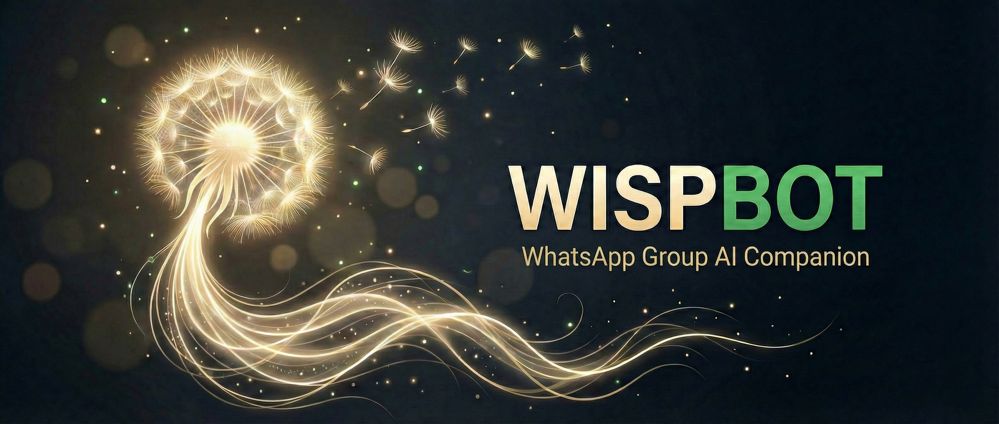

# Wispbot — Bring AI to your WhatsApp groups

---

<p align="center">
  
</p>

---

An AI-powered WhatsApp group chat bot with a web-based admin panel. Built with [Baileys](https://github.com/WhiskeySockets/Baileys) and Google Gemini.

```bash
git clone https://github.com/najibelmokhtari/wispbot.git && cd wispbot
npm install
npm start
```

- **Fact-check, brainstorm, role-play, or just have fun** — Useful in serious discussions and casual chats alike. Configurable personas can be used in each group.
- **Three commands to a working bot** — Clone, install, start. A guided wizard handles the rest — no `.env` editing required.
- **Lightweight and self-hosted** — Single Node.js process, SQLite, no cloud infra or Docker. All data stays on your machine.
- **Memory & active listening** — Remembers each group's context over time and can decide on its own when to chime in — or be configured to stay quiet until @mentioned.
- **A companion, not an agent** — Lives inside your group chats. Doesn't take actions outside the conversation. This is not an autonomous agent like OpenClaw. It will do nothing on your machine other than chat.

---

## Features

- **AI responses** — Mention the bot in any group message and it replies using Gemini
- **Active listening** — Bot can respond proactively without being @mentioned (configurable per group)
- **Per-group configuration** — Each group has its own AI model, persona, history limits, and feature flags
- **Custom personas** — Hot-swappable AI personalities via `.persona` files with metadata, voice, and TTS style
- **Community personas** — Browse and install personas from a shared [community repo](https://github.com/najibelmokhtari/wispbot-personas)
- **Message batching** — Groups rapid messages into a single context window before replying
- **Text-to-speech** — Expressive voice notes via Gemini 3.8 Flash TTS: the AI writes a voice script with per-segment delivery (whispering, shouting, singing, emotion, pace) and inline vocal events like `<laugh>` or `<sigh>`
- **Voice note understanding** — Optional per-group previews transcribe the first seconds of every voice note into the chat history, and the AI can call an `analyze_audio` tool to transcribe or ask questions about any voice note on demand
- **Image understanding** — Reads and describes images sent in the chat
- **Audio understanding** — Processes voice messages and audio files
- **Web search** — Can search the web and summarize results (toggleable per group)
- **Group memory** — Background processor summarizes and persists group memories as markdown files
- **Admin panel** — Web UI to manage groups, users, personas, settings, and view the QR code
- **Authorization** — Per-user whitelist, per-group auth toggles
- **Token usage tracking** — Per-user and per-group API cost estimation

---

## Prerequisites

- Node.js 18+
- Google Gemini API key ([get one here](https://aistudio.google.com/))
- (Optional) A Google Cloud service account instead of an API key (calls go through Vertex AI)
- A WhatsApp account dedicated to the bot

---

## Setup

### 1. Clone and install

```bash
git clone https://github.com/najibelmokhtari/wispbot.git
cd wispbot
npm install
```

### 2. Start the bot

```bash
npm start
```

Your browser will open automatically with a setup wizard that walks you through:

1. Entering your Gemini API key
2. Setting an admin password
3. Scanning the WhatsApp QR code
4. Naming your bot, picking a personality, and configuring engagement settings

No manual `.env` editing required — the wizard handles everything.

### CLI options

| Command | Description |
|---|---|
| `npm start` | Start the bot and open the admin panel in your browser |
| `npm run start:silent` | Start without opening the browser |
| `npm test` | Run unit tests |

You can also pass `--no-browser` directly: `node src/bot.js --no-browser`

---

## Production Deployment (PM2)

```bash
# Install PM2
npm install -g pm2

# Copy and edit the ecosystem config
cp ecosystem.config.js.example ecosystem.config.js
# Or just start directly:
pm2 start src/bot.js --name whatsapp-bot

pm2 save
pm2 startup
```

Shell scripts for common operations are in `shell/prod/`:

| Script | Action |
|---|---|
| `shell/prod/start_bot.sh` | Install deps and start via PM2 |
| `shell/prod/restart_bot.sh` | Restart the bot |
| `shell/prod/stop_bot.sh` | Stop the bot |
| `shell/prod/show_logs.sh` | Tail PM2 logs |
| `shell/prod/deploy.sh` | Pull latest code and restart |
| `shell/prod/qr.sh` | View QR code from logs |

---

## Bot Commands

Commands are prefixed with `!`. Most configuration is done through the admin panel — chat commands are kept minimal and focused on in-chat actions.

| Command | Access | Description |
|---|---|---|
| `!help` | Everyone | Show contextual help (adapts to group settings) |
| `!ping` | Admin | Check if the bot is alive |
| `!clear` | Admin | Clear the conversation history for this group |
| `!usage` | Authorized | Show your token usage stats |
| `!stop` | Admin | Emergency stop — deactivate the bot in this group |
| `!start` | Admin | Reactivate the bot after a `!stop` |
| `!addme` | Everyone | Request authorization to use the bot (groups only) |
| `!persona <name>` | Admin | Switch the group's persona on the fly |

---

## Personas

Persona files live in `prompts/personas/`. Each `.persona` file contains metadata, a system prompt, and optional TTS configuration. Manage them through the admin panel — create, edit, delete, and assign personas per group. You can also browse and install community personas from the admin panel.

The `.persona` file format:

```
[meta]
description = Short description of the persona
author = your-github-username
version = 1.0
tags = english, humor, roleplay

[voice]
Kore

[system_prompt]
Your system prompt goes here. Describe the personality, tone, style, etc.

[tts_style]
Optional voice style instructions for text-to-speech.
```

### Contributing Personas

Created a persona you think others would enjoy? You can contribute it to the [community personas repo](https://github.com/najibelmokhtari/wispbot-personas).

1. Create and test your persona in the admin panel (Personas section)
2. Find your `.persona` file in `prompts/personas/` on your server
3. Fork [wispbot-personas](https://github.com/najibelmokhtari/wispbot-personas), add your file under the appropriate language/category folder, and open a PR

---

## Group Context Files

Each group can have a context file at `prompts/group_contexts/<group_id>.txt` that provides the bot with background about the group. See `prompts/group_contexts/example.txt` for the format.

---

## Architecture

```
src/
├── bot.js                    # Entry point, WhatsApp client setup
├── config.js                 # All config loaded from env vars
├── message-queue.js          # Batches messages, calls AI, sends replies
├── message-processor.js      # Routes messages to commands or AI
├── active-listener.js        # Proactive response system
├── background-processor.js   # Async memory summarization
├── conversation-store.js     # Per-group message history
├── db.js                     # SQLite database layer
├── persona-parser.js         # .persona file parser
├── token-usage-tracker.js    # Per-user/per-group token counting
├── pricing-config.js         # Cost calculation for Gemini models & TTS
├── ai/
│   └── gemini.js             # Gemini API client
├── background-handlers/
│   └── memories.js           # Group memory extraction handler
├── commands/                 # One file per bot command
├── admin/                    # Express admin panel (routes, views, public assets)
├── services/
│   ├── auth.js               # Authorization & user management
│   └── tts.js                # Text-to-speech (Gemini TTS)
└── cli/                      # Operational CLI scripts
```

Data is stored in SQLite (`data/database.sqlite`) with WAL mode for concurrency.

---

## Environment Variables

See `.env.example` for a full list with descriptions.

**Required:**
- `GEMINI_API_KEY` — Google Gemini API key (or use a service account below)

**Important optional:**
- `BOT_NAME` — Display name of the bot (default: `Wisp`)
- `AI_MODEL` — Gemini model to use (default: `gemini-4-argon`)
- `ADMIN_PASSWORD` — Password for the admin panel
- `ADMIN_SESSION_SECRET` — Secret for session signing (auto-generated if not set)
- `ADMIN_HOST` — Bind address (default: `127.0.0.1`, set to `0.0.0.0` for remote access)
- `ADMIN_PORT` — Admin panel port (default: `3000`)
- `GOOGLE_SERVICE_ACCOUNT_FILE` — Path to a Google Cloud service account key file; when set, all Gemini calls (chat, memories, active listening, TTS) go through Vertex AI
- `GOOGLE_SERVICE_ACCOUNT_JSON` — The service account key as a JSON string (alternative to the file)
- `VERTEX_REGION` — Vertex AI location for service account calls (default: `global`)
- `GEMINI_AUTH` — Force `api_key` or `service_account` (default: service account if configured, otherwise API key)

---

## Data & Privacy

The bot stores messages, media, and user info locally to function. Here's what lives on your server:

| Location | What's in it |
|---|---|
| `data/database.sqlite` | Conversations, user info, group settings, usage stats |
| `data/images/` | Images sent in chats |
| `data/audio/` | Voice messages sent in chats |
| `data/group_memories/` | AI-generated group memory summaries (markdown files) |
| `prompts/group_contexts/` | Custom per-group context files |
| `auth_session/` | WhatsApp session credentials |

Nothing is sent to third parties beyond the Gemini API calls needed to generate responses.

### Heads up for group members

When the bot is active in a group, it stores and processes messages to generate replies. Consider letting group members know the bot is there and what it does — most people appreciate a quick heads-up.

### Wiping all data

To do a full reset and remove everything the bot has stored:

```bash
# Stop the bot first
pm2 stop whatsapp-bot  # or Ctrl+C if running directly

# Remove all data
rm -rf data/              # Database, images, audio, memories
rm -rf auth_session/      # WhatsApp session (you'll need to re-scan QR)
rm -rf prompts/group_contexts/  # Group context files

# Restart fresh
npm start
```

To selectively clear only conversations while keeping settings and users:

```bash
# Delete just the database (settings, users, and conversations)
rm data/database.sqlite*
```

The bot will recreate the database with empty tables on next startup.

---

## Disclaimer

This project uses [Baileys](https://github.com/WhiskeySockets/Baileys), an unofficial, reverse-engineered WhatsApp Web client. This is **not** sanctioned by WhatsApp — using it violates their Terms of Service and your account could be temporarily or permanently banned. Use a dedicated phone number you can afford to lose, not your personal one.

---

## Author

Created and maintained by **Najib El Mokhtari** — [@najibelmokhtari](https://github.com/najibelmokhtari)

---

## License

MIT © Najib El Mokhtari
